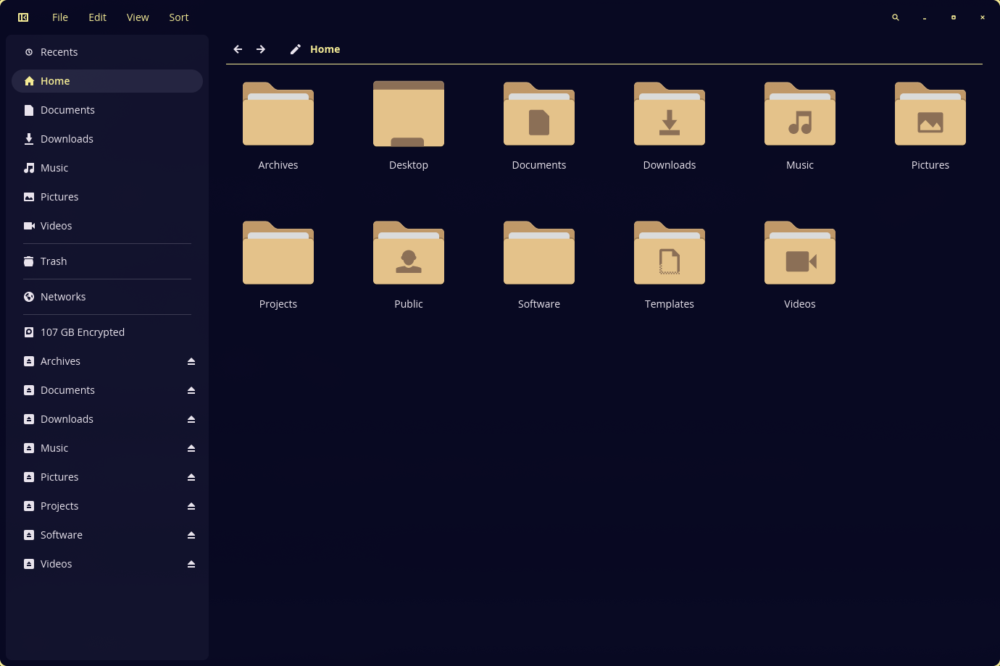
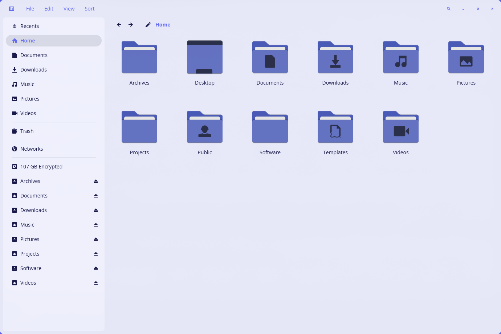
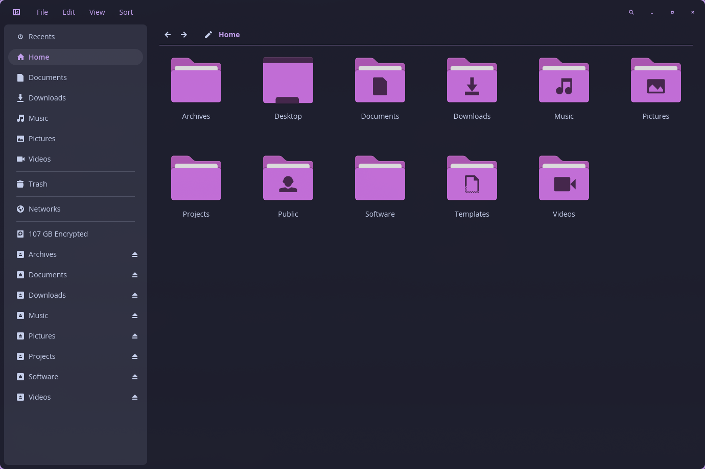
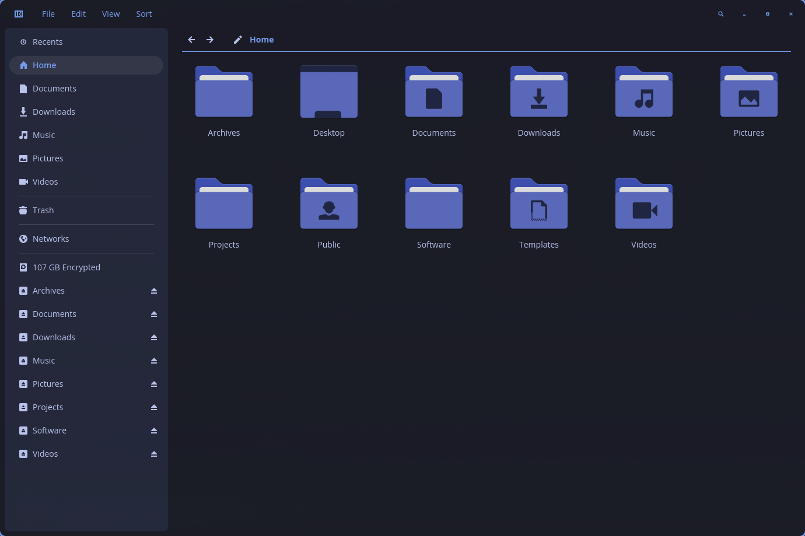

# COSMIC

Keeps [COSMIC](https://system76.com/cosmic) applications built on libcosmic in
sync with the Noctalia palette: `cosmic-files`, `cosmic-edit`, `cosmic-term` and
friends.

## Screenshots

`cosmic-files` with the built-in Noctalia palette:

| Dark | Light |
| --- | --- |
|  |  |

The same theme driven by two other built-in palettes:

| Catppuccin | Tokyo Night |
| --- | --- |
|  |  |

## What it writes

COSMIC stores its theme in `~/.config/cosmic`:

| Path | Purpose |
| --- | --- |
| `com.system76.CosmicTheme.Dark/v2/` | the derived dark theme libcosmic reads |
| `com.system76.CosmicTheme.Light/v2/` | the derived light theme libcosmic reads |
| `com.system76.CosmicTheme.Dark.Builder/v2/` | palette and inputs `cosmic-settings` edits |
| `com.system76.CosmicTheme.Light.Builder/v2/` | palette and inputs `cosmic-settings` edits |
| `com.system76.CosmicTheme.Mode/v1/is_dark` | selects dark or light at startup |
| `com.system76.CosmicTk/v1/apply_theme_global` | set to `false` so Noctalia keeps GTK/Qt theming |

The file layout and serialization are the same ones `cosmic-settings` persists
after building a theme, so this is equivalent to selecting a custom theme in
Settings. Both modes are written on every apply, which means flipping Noctalia
between dark and light updates COSMIC immediately.

## Scope

Theming happens at the toolkit level, not per app. The files above are read by
`cosmic-config` and turned into a `cosmic_theme::Theme`, which `libcosmic` then
uses to draw every widget. So any application built on libcosmic follows
automatically: `cosmic-files`, `cosmic-edit`, `cosmic-term`, `cosmic-player`,
`cosmic-store`, the panel and its applets.

`cosmic-comp` reads the same theme for the parts the compositor draws itself:
`window_hint` and `accent_color` for the focused-window hint, `frosted` /
`frosted_windows` / `active_hint` for blur and hint strength.

What this does not reach:

- Apps that are not built on libcosmic (GTK, Qt, browsers). They need their own
  template; `com.system76.CosmicTk/v1/apply_theme_global` is set to `false` so
  COSMIC does not override the GTK/Qt theming Noctalia owns.
- Sandboxed (Flatpak) libcosmic apps, which keep their own
  `~/.var/app/<id>/config` and only see this if granted access to the host
  config directory.
- Changes are live only where `cosmic-settings-daemon` is running to deliver
  config watcher notifications; otherwise apps pick the theme up on next launch.

## Requirements

- A COSMIC application launched at least once, so `~/.config/cosmic` exists.
  The template is skipped until then.
- `python3`.

## Tested against

- COSMIC epoch 1.10.0 (`cosmic-files` 1.0.0, `cosmic-edit` 1.0.0) on Arch Linux.

## Reverting

Run the shipped `undo.sh` to remove the generated theme and let libcosmic fall
back to COSMIC's built-in theme:

```sh
bash "${XDG_STATE_HOME:-$HOME/.local/state}/noctalia/community-templates/cosmic/undo.sh"
```

Noctalia currently runs `undo_hook` only for built-in templates, so community
manifests cannot reference the script; it is shipped for manual use until
community templates gain undo support. The derived theme directory is fully
owned by this template, so undoing discards any theme customized in
`cosmic-settings` before the template was enabled.

## Notes

- Containers follow the neutral surface ramp rather than Material's tinted
  `*_container` roles: the window is `surface`, the nav sidebar is
  `surface_container` (the role Noctalia's GTK template uses for
  `sidebar_bg_color`), and nested panels are `surface_container_high`. Mapping
  them to `primary_container` painted sidebars a saturated accent color.
- Icon, list, text and link buttons are flat: a transparent base with a
  translucent hover/pressed overlay, which is also what libcosmic's own defaults
  do. A solid `icon_button.base` turns the titlebar window controls into filled
  circles, because libcosmic paints them at `radius_xl`.
- COSMIC has no dedicated warning color, so Noctalia's `tertiary` is used for it.
- Frosted surfaces are left disabled, matching COSMIC's default appearance.
- The `Builder` config is written so installing `cosmic-settings` later shows
  the palette as a normal custom theme instead of the built-in default.
